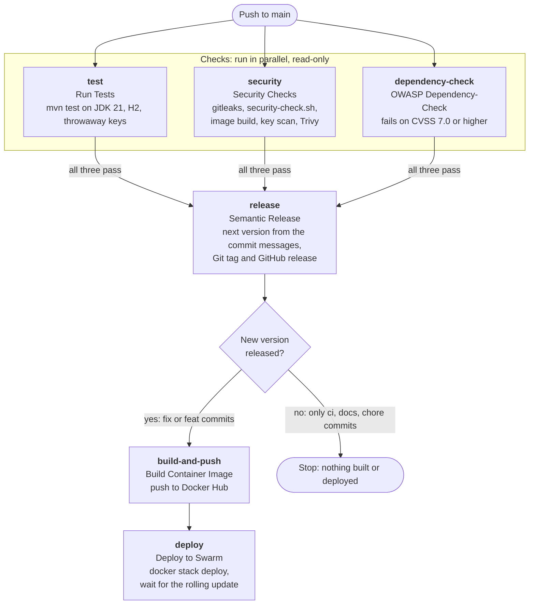

# Deployment (CI/CD)

The Tasks API is tested, scanned, released, built and deployed by one GitHub Actions workflow,
`.github/workflows/ci.yml`, on every push to `main`. This page explains what the workflow does,
what it needs, and how to fix it when a run fails.

## Pipeline at a glance



The first three jobs run in parallel and only read the repository. Nothing is tagged, built or deployed
unless all three pass. Pull requests do not trigger the workflow; only pushes to `main` do.

## When a push deploys, and when it does not

The version comes from the commit messages since the last release
([Conventional Commits](https://www.conventionalcommits.org/)), read by semantic-release:

| Commit messages since the last release include | New version | Built and deployed? |
|---|---|---|
| `fix: ...` | patch, e.g. 1.4.0 → 1.4.1 | Yes |
| `feat: ...` | minor, e.g. 1.4.0 → 1.5.0 | Yes |
| `feat!: ...` or a `BREAKING CHANGE:` footer | major, e.g. 1.4.0 → 2.0.0 | Yes |
| only `ci:`, `docs:`, `chore:`, `test:`, `refactor:`, `style:` | none | **No.** The checks still run, but the release job publishes nothing, so `build-and-push` and `deploy` are skipped |

To ship a change, at least one commit since the last release must be a `fix:` or `feat:`.

## Container image

`build-and-push` pushes `<DOCKER_USERNAME>/task-service` to Docker Hub with four tags:

| Tag | Example | Use |
|---|---|---|
| the version | `1.5.0` | What you normally deploy or roll back to |
| the Git tag | `v1.5.0` | Matches the GitHub release |
| `latest` | `latest` | The most recent release |
| the commit | `sha-<full commit hash>` | Ties an image to the exact commit |

The deploy job does not use a tag on its own. It passes `IMAGE_TAG=<version>@<digest>`
(for example `1.5.0@sha256:…`), so the swarm runs exactly the image that was just built and scanned,
even if a tag is later moved.

## One-time setup

### 1. GitHub repository secrets

*Settings → Secrets and variables → Actions → New repository secret*

| Secret | Used by | Value |
|---|---|---|
| `DOCKER_USERNAME` | build-and-push | Docker Hub user name (also the image namespace) |
| `DOCKER_TOKEN` | build-and-push | Docker Hub access token with read and write access, not the account password |
| `SSH_PRIVATE_KEY` | deploy | Private key of a key pair made only for deploys, e.g. `ssh-keygen -t ed25519 -f deploy_key -N ""`. Its public half goes in the manager's `~/.ssh/authorized_keys` |
| `SSH_KNOWN_HOSTS` | deploy | The manager's host key, from `ssh-keyscan -t ed25519 <manager-host>`. Check the fingerprint before saving it |
| `SSH_USER` | deploy | The account the workflow logs in as on the manager |
| `SSH_HOST` | deploy | The manager's host name or IP address |
| `NVD_API_KEY` | dependency-check | **Optional.** Without it, Dependency-Check uses its own daily mirror of the NVD data |

`GITHUB_TOKEN` is provided automatically. The workflow gives it permission to push tags and releases.

### 2. The swarm manager

The deploy job logs in over SSH and runs these commands on the manager:

```bash
set -a; source tasks.env; set +a                 # load the stack's variables
sudo -E docker stack deploy --with-registry-auth -c stack-tasks.yml tasks
```

So the manager needs:

- **Docker in swarm mode** (`docker swarm init`, or a manager node of an existing swarm).
- **`sudo` for `docker` without a password prompt** for `SSH_USER`, because nobody is there to type one.
  Grant it for the docker binary only, e.g. `/etc/sudoers.d/deploy`:
  `deployer ALL=(root) NOPASSWD: /usr/bin/docker`
- **`~/tasks.env`** in `SSH_USER`'s home folder, holding every variable `stack-tasks.yml` uses
  (database password, `JWT_ISSUER`, `JWT_AUDIENCE` and so on). It lives only on the manager:
  never commit it, and keep it readable by `SSH_USER` only (`chmod 600 ~/tasks.env`).
- **The RS256 public key** (`public.pem`) wherever `stack-tasks.yml` expects it.
  Only the public key; the private key belongs to the Users Service alone.
- **Docker Hub access to the image.** `--with-registry-auth` passes the manager's Docker Hub login to
  the worker nodes. If the repository is private, log in once on the manager with `sudo docker login`.

### 3. The stack file

`stack-tasks.yml` must be committed in the repository root; the workflow copies it to the manager on
every deploy. Its image line must use the `IMAGE_TAG` the workflow sets, for example:

```yaml
services:
  task-service:
    image: ${DOCKER_USERNAME}/task-service:${IMAGE_TAG}
```

`DOCKER_USERNAME` is not sent by the workflow, so set it in `tasks.env`, or write the user name into the
file. The service must be called `task-service`, so that its swarm name is `tasks_task-service`, the
name the deploy job waits on.

If the stack file defines a `healthcheck:`, use `wget` (BusyBox), not `curl`. The runtime image has no
`curl`, and a failing health check makes the swarm roll the update back.

## What the deploy job does

1. Writes the SSH key and known hosts, and copies `stack-tasks.yml` to `~/stack-tasks.yml` on the manager.
2. Loads `~/tasks.env` and runs `docker stack deploy` with the new `IMAGE_TAG`.
3. Polls the service's update state every 10 seconds for up to 10 minutes:
   - `completed`: prints `docker stack services tasks` and succeeds.
   - `rollback_started`, `rollback_completed`, `rollback_paused` or `paused`: prints the last task history
     and fails. The swarm is still running the previous version.
   - no answer within 10 minutes: prints the task history and fails.
4. Deletes the SSH key from the runner, whether the deploy succeeded or not.

Two deploys of this repository never run at the same time, and a running deploy is never cancelled
halfway: a newer deploy waits for it to finish. If several are waiting, GitHub keeps only the newest.

## Rolling back

The image of every release stays on Docker Hub. To return to an earlier version:

```bash
# on the swarm manager
sudo docker service update --with-registry-auth \
  --image <DOCKER_USERNAME>/task-service:1.4.1 tasks_task-service
```

For a quick undo of the last update, `sudo docker service rollback tasks_task-service` returns to the
previous image. Either way, the next successful pipeline run deploys the newest release again.

## Troubleshooting

| Failed job or step | Likely cause | What to do |
|---|---|---|
| Run Tests | A test failed | Download `surefire-reports` from the run's artifacts |
| Security Checks → Secret scan | gitleaks found a secret, or `.gitleaks.toml` / `.gitleaksignore` is missing | See `SECURITY-CHECKS.md`. Rotate a real secret first; record reviewed old findings in `.gitleaksignore` |
| Security Checks → Key and config hygiene | `scripts/security-check.sh` failed | Its log names the file, line and fix. Run it locally first |
| Security Checks → Vulnerability scan | Trivy found a fixable HIGH or CRITICAL CVE in the image | Upgrade the package or base image. Do not add packages to the runtime stage |
| OWASP Dependency-Check | A library has a CVE of 7.0 or higher | Read `dependency-check-report` in the run's artifacts. Upgrade the library, usually through the Spring Boot parent |
| Semantic Release succeeds, later jobs skipped | No `fix:` or `feat:` commit since the last release | Expected. See "When a push deploys" above |
| Build Container Image → login | `DOCKER_USERNAME` or `DOCKER_TOKEN` wrong, or the token lacks write access | Create a new Docker Hub access token and update the secret |
| Deploy → Set up SSH / copy | `Permission denied (publickey)` or `Host key verification failed` | Check the public key is in `SSH_USER`'s `authorized_keys`, and refresh `SSH_KNOWN_HOSTS` |
| Deploy → `sudo: a password is required` | No passwordless `sudo` for docker | Add the sudoers entry above |
| Deploy → `tasks.env: No such file or directory` | The env file is missing on the manager | Create `~/tasks.env` for `SSH_USER` |
| Deploy → `rollback_*` or `paused` | The new containers did not become healthy | Read the task history in the log; on the manager, `sudo docker service logs tasks_task-service`. Often a missing variable in `tasks.env`, a wrong key path, or a health check that fails |
| Deploy → timed out | The update was still running after 10 minutes | Check `sudo docker service ps tasks_task-service --no-trunc` on the manager |

## Related documents

- `SECURITY-CHECKS.md`: what the three check jobs cover, and how to run them locally
- `README-Dockerfile.md`: the image build
- `README-docker-compose.md`: running the stack locally