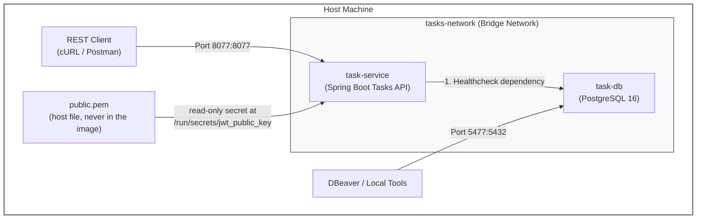

# docker-compose Walkthrough

This configuration orchestrates two isolated services on a local bridge network:

- `task-db`: A dedicated PostgreSQL 16 database running on Alpine Linux.

- `task-service`: A Spring Boot microservice containerized via multi-stage builds and tuned for containerized JRE memory management. It validates incoming RS256 JWT tokens using an RSA public key.



## Prerequisite: verification key

`task-service` verifies RS256 JWT tokens issued by `user-service`. It requires the RSA public key (`public.pem`) on the host filesystem prior to launching `docker compose up`. If you have already generated key pairs for the project, ensure `public.pem` exists in `~/.taskflow/keys/`:

```bash
mkdir -p ~/.taskflow/keys
# If generating standalone keys for local testing:
openssl genpkey -algorithm RSA -pkeyopt rsa_keygen_bits:2048 -out ~/.taskflow/keys/private.pem
openssl rsa -pubout -in ~/.taskflow/keys/private.pem -out ~/.taskflow/keys/public.pem
chmod 644 ~/.taskflow/keys/public.pem
```

Note: The Tasks API **only** verifies tokens using `public.pem` and never contains token-issuing logic or private keys.

## Environment Configuration

Create a `.env` file in the same root directory as `docker-compose.yml` to store database credentials and runtime parameters out of source control.

```bash
# Database Settings
# The app reaches the database by its compose service name (Docker DNS), never localhost.
DB_HOST_ENV=task-db
# Host port only. The container still listens on 5432 inside the network.
# 5477 avoids a clash with local PostgreSQL or other service databases.
DB_HOST_PORT_ENV=5477
DB_NAME_ENV=taskflow-tasks
DB_USER_ENV=postgres
DB_PASSWORD_ENV=postgrespassword

# Application Settings
APP_PORT_ENV=8077

# Security Settings (RS256 Signature Verification)
# The tasks API must be configured with the same issuer and audience as user-service
JWT_ISSUER_ENV=user-service
JWT_AUDIENCE_ENV=taskflow-api

# Optional: host path of the public key (the compose file defaults to ~/.taskflow/keys/public.pem)
# JWT_PUBLIC_KEY_PATH=/home/you/.taskflow/keys/public.pem

# Optional: run the container as your host user (find yours with `id -u` and `id -g`; both default to 1000)
# LOCAL_UID=1000
# LOCAL_GID=1000
```

### Database host and port: which values, where

The database connection parameters vary depending on where the application or client tools are executing. `DB_HOST_PORT_ENV` dictates the port published on your host system. Inside the Docker bridge network, `task-db` listens on internal port `5432`.

| Where the app/tool runs | Database host | Database port |
|---|---|---|
| In Docker Compose (`task-service` container) | `task-db` (`DB_HOST_ENV`) | `5432`, fixed |
| `mvn` on your host machine, against compose DB | `localhost` | published port, `DB_HOST_PORT_ENV` (5477) |
| DBeaver or other SQL tools on host | `localhost` | published port, `DB_HOST_PORT_ENV` (5477) |
| Cloud platform (e.g., Railway) | Platform DB host variable | Platform DB port variable |

## `task-db` Service

1. **image:** `postgres:16-alpine`: Utilizes a lightweight Alpine Linux distribution of PostgreSQL 16 to minimize container resource overhead.

2. **volumes:** `task_db_data:/var/lib/postgresql/data`: Mounts a named Docker volume to store PostgreSQL data directories, preserving database state across container lifecycles.

3. **healthcheck:** Periodically executes `pg_isready` every 5 seconds to verify that PostgreSQL is actively accepting socket queries before downstream dependents launch.

## `task-service` Service

1. **build & image:** Compiles the application using the local `Dockerfile` and tags the generated image as `ensanguine/task-service:latest`.

2. **environment:** Overrides Spring Boot property defaults dynamically at runtime. `DB_HOST` maps to `DB_HOST_ENV` (`task-db`), enabling container-to-container DNS resolution. `JWT_ISSUER` and `JWT_AUDIENCE` enforce strict claim matching against incoming `Bearer` JWTs. `JWT_PUBLIC_KEY_PATH` points to `/run/secrets/jwt_public_key`, the internal mount location of the secret.

3. **user:** `"${LOCAL_UID:-1000}:${LOCAL_GID:-1000}"` sets the container user and group ID to match your host system user, ensuring unprivileged execution while maintaining access to mounted secrets.

4. **ports:** `"${APP_PORT_ENV:-8077}:${APP_PORT_ENV:-8077}"` maps host port 8077 to container port 8077 for inbound REST requests (`/api/tasks`).

5. **secrets:** `jwt_public_key` mounts the host's `public.pem` file as a read-only secret at `/run/secrets/jwt_public_key`.

6. **depends_on.condition:** Uses `condition: service_healthy` to defer Spring Boot startup until `task-db` successfully passes its `pg_isready` health check.

    **Step-by-Step lifecycle flow**

    1. **Service Spawn:** Docker Compose boots `task-db`.
    2. **Healthcheck Loop:** Docker Compose periodically runs the health check inside `task-db`:
       ```bash
       test: ["CMD-SHELL", "pg_isready -U ${DB_USER_ENV} -d ${DB_NAME_ENV}"]
       interval: 5s
       timeout: 5s
       retries: 5
       ```
    3. **Status Upgrade:** Once PostgreSQL initializes, `pg_isready` returns exit code `0`, marking `task-db` as healthy.
    4. **Unblocking Dependent Service:** Docker Compose evaluates the `service_healthy` condition and initiates `task-service`.

## Networks & Volumes

- `tasks-network`: An isolated bridge network facilitating private communication between `task-service` and `task-db`.

- `task_db_data`: A managed volume declared at the root level to persist task tables and indexes on disk.

## Secrets

`jwt_public_key` is declared at the top level of the Compose file and resolved from the host:

```yaml
secrets:
  jwt_public_key:
    file: ${JWT_PUBLIC_KEY_PATH:-${HOME}/.taskflow/keys/public.pem}
```

Path breakdown:

| Scope | Variable / Path | Purpose |
|---|---|---|
| Host | `${JWT_PUBLIC_KEY_PATH}` or `${HOME}/.taskflow/keys/public.pem` | Host file path used by Docker Compose during mount initialization |
| Container | `/run/secrets/jwt_public_key` | Container file path read by Spring Boot's `PemKeyLoader` |

- Standard POSIX variable syntax `${HOME}` is used because Docker Compose does not expand tilde (`~`).
- `task-service` only mounts `public.pem`. Private keys are never referenced or mounted into this service.

## Execution Workflow

### 1. Pre-flight Verification

Confirm that the RSA public key exists on the host, then validate Docker Compose string substitution:

```bash
ls -l ~/.taskflow/keys/public.pem
docker compose config
```

Verify in the `docker compose config` output that `secrets.jwt_public_key` points to your public key file and that `JWT_ISSUER` and `JWT_AUDIENCE` match `user-service` configuration.

### 2. Build and Launch Containers

Build the application image and start services in detached mode (`-d`):

```bash
docker compose up --build -d
```

### 3. Monitor Startup Sequence

Verify container status as `task-db` shifts from starting to healthy and `task-service` starts up:

```bash
docker compose ps
```

### 4. Stream Application Logs

Follow real-time Spring Boot application logs to confirm token parser initialization and database connection setup:

```bash
docker compose logs -f task-service
```
*(Press `Ctrl + C` to stop streaming).*

### 5. Connect External Tools (DBeaver)

Connect host database clients to the exposed PostgreSQL port:

- **Host:** `localhost`
- **Port:** `5477` (or value of `${DB_HOST_PORT_ENV}`)
- **Database:** `taskflow-tasks` (or value of `${DB_NAME_ENV}`)
- **User/Password:** Credentials declared in `.env`

### 6. Smoke Test

Run the end-to-end integration test from the project root:

```bash
./smoke-test.sh --up --restart
```

This test rebuilds the stack, logs in via the Users Service, checks issued tokens against the contract (`iss`, `aud`, `uid`, expiration), sends requests to `/api/tasks` endpoints, verifies ownership checks and role rules, and validates rejection of forged or tampered JWTs.

### 7. Cleanup & Maintenance Operations

Stop containers while preserving database volume data:

```bash
docker compose down
```

Full Reset (Stops containers and removes persistent database volume):

```bash
docker compose down -v
```

## Troubleshooting

| Symptom | Likely cause and fix |
|---|---|
| `Could not load public key ... NoSuchFileException` | Secret is not mounted, or `JWT_PUBLIC_KEY_PATH` in application properties is not `/run/secrets/jwt_public_key`. |
| `File contains a private key` on startup | The host key file mounted to `jwt_public_key` contains a private key (`BEGIN PRIVATE KEY`). `PemKeyLoader` refuses private keys in `task-service`. Mount `public.pem` instead. |
| `docker compose up` fails on secret resolution | Key file does not exist at host path. Run `docker compose config` to inspect the resolved path and ensure `public.pem` is present. |
| No response on `localhost:8077` | `APP_PORT_ENV` mismatch or service crash. Check `docker compose logs task-service` for startup exceptions. |
| `Unable to determine Dialect without JDBC metadata` | Database unreachable. Verify `task-db` health and ensure `DB_HOST_ENV` is set to `task-db` (not `localhost`) inside Compose. |
| `Bind for 0.0.0.0:5477 failed: port is already allocated` | Host port conflict. Change `DB_HOST_PORT_ENV` in `.env` to an unused host port. |
| All incoming requests return 401 Unauthorized | Issuer or audience mismatch between `user-service` and `task-service`, or token missing required `uid` claim. |